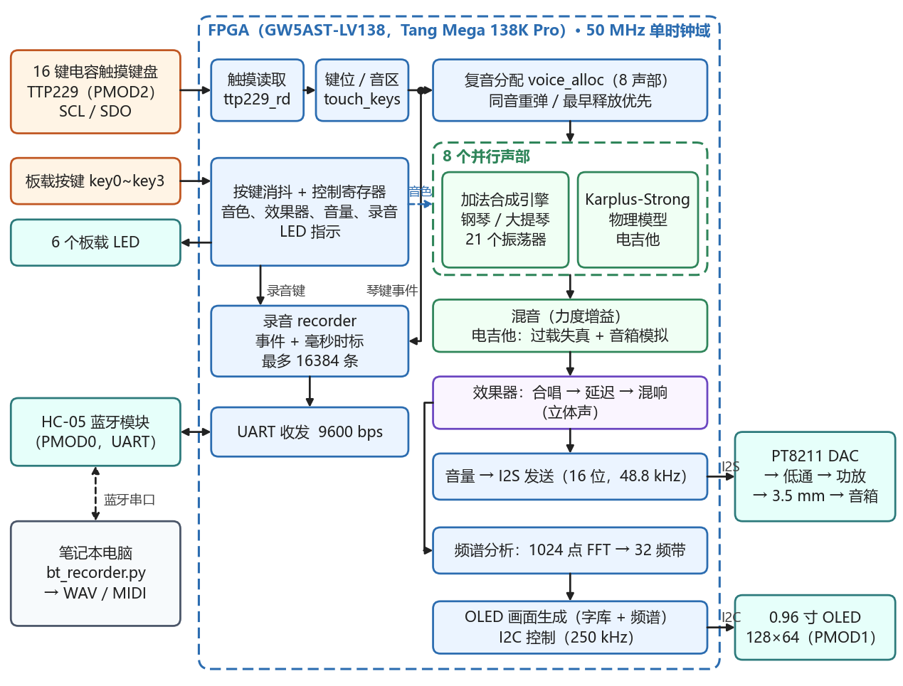
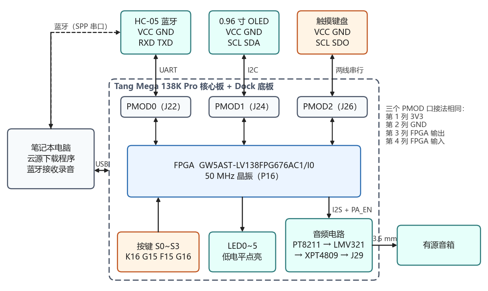
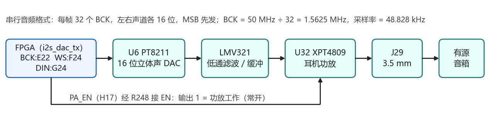
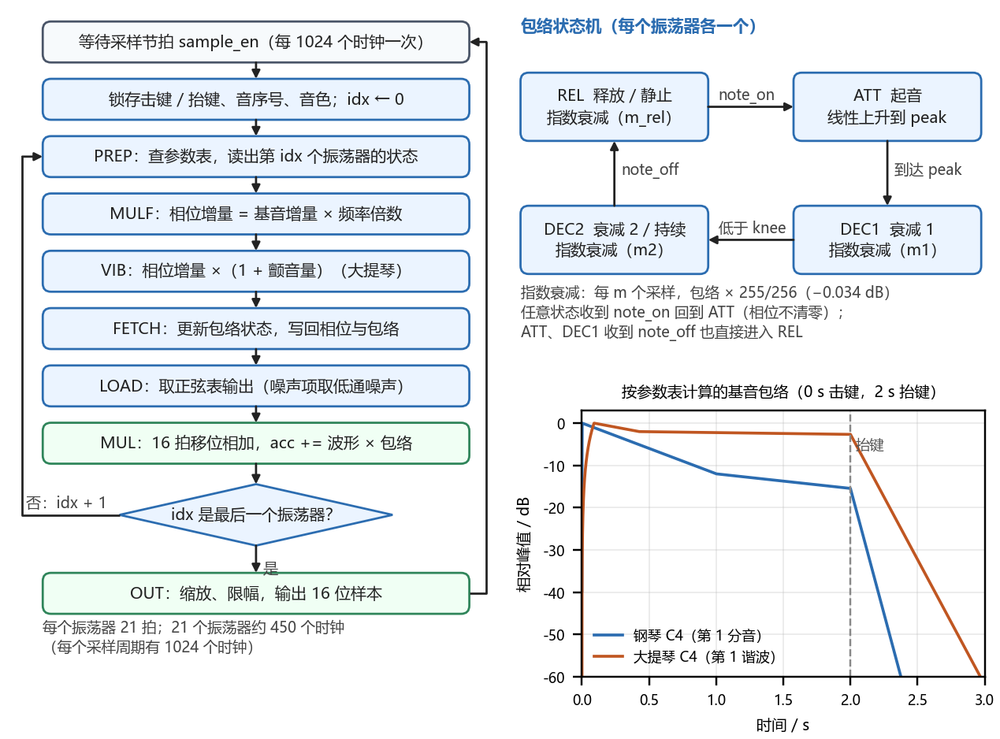
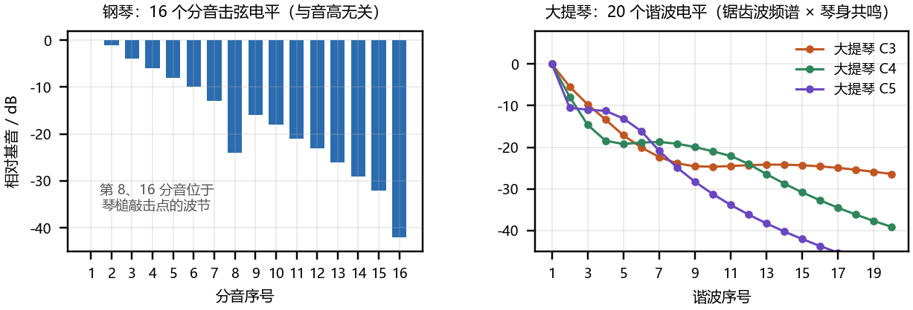
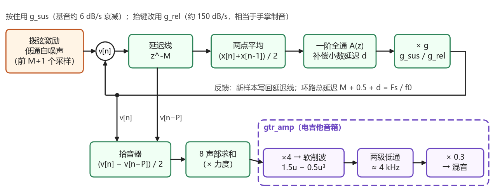
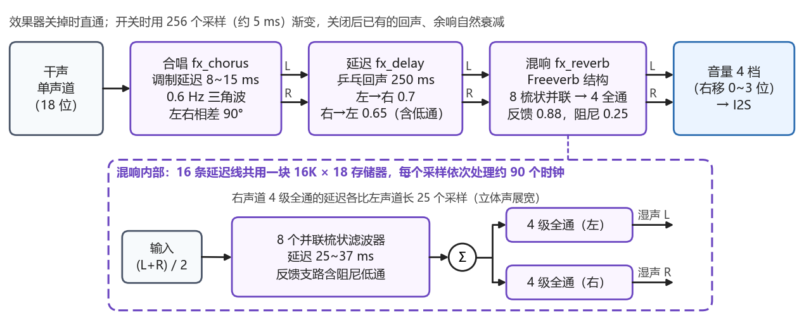
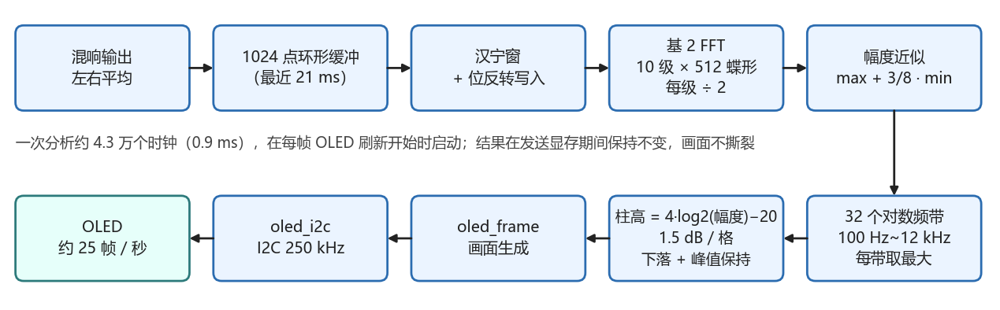
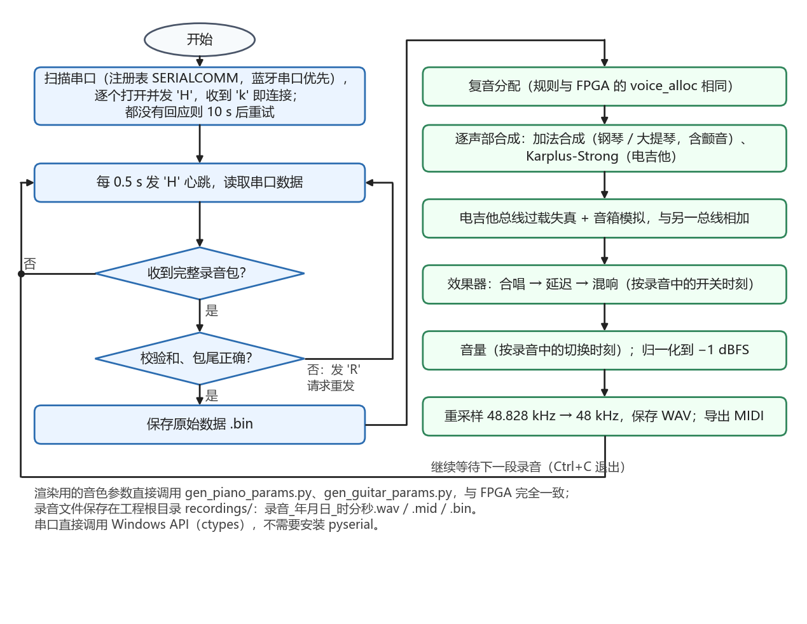
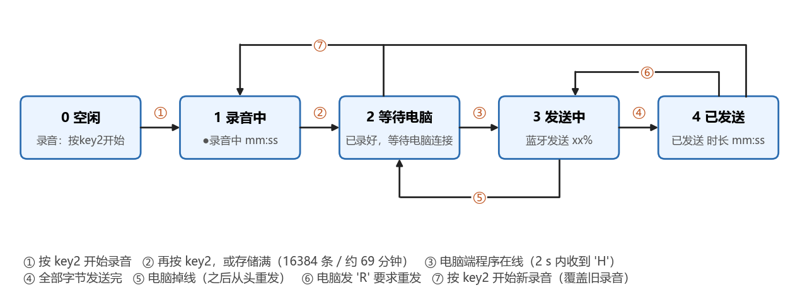

# 基于 FPGA 的多音色数字合成器键盘


一款在单颗国产高云 FPGA 上实现的便携式数字合成器。以 16 键电容触摸键盘为输入，实时合成**钢琴、电吉他、大提琴**三种音色，内置**混响、延迟、合唱**三种效果器，支持 **8 复音**与实时 FFT 频谱，并可通过蓝牙将演奏录音上传电脑，渲染为 WAV 与 MIDI。

全部发声、音效与频谱算法均在 FPGA 内以定点流水线并行实现，无需外部处理器，触摸到发声延迟小于 7 ms。

---

## 系统框图



系统以 FPGA 为核心，分为输入、处理、输出三部分：

- **输入**：触摸键盘（TTP229，两线串行）→ 触摸读取模块；4 个功能按键经消抖产生控制信号；HC-05 蓝牙经 UART 与录音模块相连。
- **处理**：复音分配器把按键事件分配到 8 个发声通道，各通道按当前音色选择加法合成或拨弦物理模型；输出经效果器链（合唱 → 延迟 → 混响）处理后混音，同时送入频谱模块做 1024 点 FFT。
- **输出**：I2S 驱动 PT8211 数模转换，经 XPT4809 功放与 3.5 mm 接口发声；OLED 汇总状态与频谱经 I2C 显示。

---

## 功能特性

- 16 键电容触摸键盘，支持多指同时弹奏，配合低 / 中 / 高三组音区切换，覆盖 A2 ~ F#6 音域。
- 三种音色一键切换：钢琴、电吉他、大提琴，各自具有独立的发声结构与包络特征。
- 三种效果器：混响、延迟、合唱，可单选或三个全开，按干湿比例混合。
- 8 复音同时发声，支持和弦演奏。
- 0.96 寸 OLED 实时显示音色、效果、音区、音量、按键状态与 32 柱频谱。
- 事件级录音：记录按键与控制变化，经蓝牙上传电脑，生成 WAV 与 MIDI。
- 四档音量（0 / -6 / -12 / -18 dB）与 6 个状态指示灯。

---

## 硬件组成

| 模块 | 器件 / 规格 | 接口 | 连接 |
|---|---|---|---|
| FPGA 核心板 | GW5AST-LV138FPG676AC1/I0（GW5AST-138B），50 MHz 晶振 | — | Tang Mega 138K Pro |
| 触摸键盘 | 16 键电容模块，TTP229 | SCL / SDO 两线串行 | PMOD2 |
| 显示屏 | 0.96" 128×64 OLED，SSD1306 / SSD1315 | I2C（地址 0x78） | PMOD1 |
| 蓝牙 | HC-05 | UART 9600 bps | PMOD0 |
| 音频 DAC | PT8211，16 bit 立体声 | I2S | Dock 底板 |
| 功放 | XPT4809（PA_EN 常开） | 模拟 | 3.5 mm 接口 |
| 功能按键 | 4 个实体按键（20 ms 消抖） | LVCMOS33，上拉 | K16 / G15 / F15 / G16 |



### 时钟与音频通路

设计工作在 **50 MHz 单一时钟域**（无真正 PLL，`pll_audio` 为 50 MHz 直通），通过分数分频产生平均 6.25 MHz 的时钟使能（= 4 × BCK）；BCK = 1.5625 MHz（= 32 × Fs），采样率 Fs = 48828.125 Hz，16 bit 立体声。



---

## 操作说明

### 实体按键（4 个，按下为低）

| 按键 | 引脚 | 功能 |
|---|---|---|
| key[0] | K16 | 效果器循环：干声 → 混响 → 延迟 → 合唱 → 三个全开 → 干声 |
| key[1] | G15 | 音量，每按一次减 6 dB（上电默认 -12 dB） |
| key[2] | F15 | 录音开始 / 停止，停止后自动经蓝牙发送 |
| key[3] | G16 | 音色循环：钢琴 → 电吉他 → 大提琴（上电默认钢琴） |

### 音区与音域

- 触摸键盘 **KEY16**（最右侧带钢琴图标的键）切换音区：中音 → 高音 → 低音（上电默认中音）。
- 音域：低音 A2 ~ B3、中音 C4 ~ D5、高音 E5 ~ F#6。
- 大提琴比钢琴低一个八度，按住持续发声并带颤音。

---

## 音色与效果器

### 三种音色

- **钢琴**：加法合成。相位累加器寻址正弦表，多个正弦分音按谐波关系相加，各分音经独立指数衰减包络加权，电平随音高变化。
- **大提琴**：加法合成基础上叠加慢速 LFO 颤音（各声部 5.2 ~ 5.9 Hz），持续发声。
- **电吉他**：拨弦物理模型（Karplus-Strong 类）。以经低通与梳状滤波的噪声激励 256 点 IIR 弦，弦系数按每 256 采样分时更新以节省资源；随后经 `gtr_amp` 做分段软削波过载与低通音箱模拟。







### 三种效果器

信号链顺序为 **合唱 → 延迟 → 混响**：

- **混响**：Schroeder 结构，4 路并联梳状延迟 + 全通扩散，反馈衰减。
- **延迟**：BSRAM 环形缓冲实现带反馈的回声。
- **合唱**：LFO 调制延迟长度，两路不同相位产生立体声加宽。



### 实时频谱

对混响输出（音量调节前，左右平均）做 1024 点 FFT，聚合为 32 根频谱柱并对数压缩，约 21 帧 / 秒。



---

## 目录结构

```
.
├── src/                    Verilog 源码
│   ├── top_touch_synth.v   顶层：时钟、复位、模块互连
│   ├── touch/              TTP229 读取与触摸按键映射
│   ├── voice_alloc.v       8 复音分配
│   ├── piano/              加法合成（钢琴 / 大提琴）
│   ├── guitar/             拨弦物理模型 + 音箱失真
│   ├── fx/                 混响 / 延迟 / 合唱
│   ├── spectrum/           1024 点 FFT 与频谱
│   ├── oled/               OLED 画面生成与 I2C
│   ├── bt/                 录音事件与 UART
│   ├── i2s_dac_tx.v        I2S 并串发送
│   └── sine_lut.*          正弦查找表
├── scripts/                Python 工具
│   ├── bt_recorder.py      电脑端：蓝牙接收并渲染 WAV / MIDI
│   ├── gen_piano_params.py 钢琴 / 大提琴参数生成
│   ├── gen_guitar_params.py 吉他参数生成
│   ├── gen_sine_lut.py     正弦表生成
│   └── gen_display_roms.py 显示 ROM 生成
├── constraints/            引脚 (.cst) 与时序 (.sdc) 约束
├── sim/                    仿真 testbench
├── docs/                   配图脚本与 images/ 图片
├── recordings/             录音产物（.bin / .wav / .mid）
├── legacy/                 早期版本与旧工程
├── impl/                   综合与布局布线结果
├── music_piano.gprj        高云工程文件
└── music_piano_pro.fs      可下载比特流
```

---

## 快速开始

### 1. 综合与下载

1. 用高云**云源软件（Gowin EDA）**打开 `music_piano.gprj`，器件为 GW5AST-LV138B。
2. 综合 → 布局布线，确认资源与时序无报错。
3. 生成并下载比特流（工程已提供 `music_piano_pro.fs`）。
4. 按上文表格连接 PMOD0 / PMOD1 / PMOD2 与音频接口，上电即可演奏（内部上电复位约 1.3 ms，无需复位按键）。

> 工程配置中需将复用的 SSPI / CPU 配置脚设为普通 IO（Use SSPI / CPU as regular IO），详见 `constraints/top_touch_synth.cst` 注释。

### 2. 电脑端录音程序

```bash
# 依赖
python -m pip install numpy scipy

# 首次使用：Windows 蓝牙设置中配对 HC-05，密码 1234
python scripts/bt_recorder.py            # 自动查找 HC-05 串口并等待录音
python scripts/bt_recorder.py --port COM5  # 手动指定串口
python scripts/bt_recorder.py --demo       # 不连硬件，渲染一段示范
python scripts/bt_recorder.py --render recordings/示范.bin  # 重新渲染已有录音
```

在电子琴上按 key[2] 开始录音、再按一次停止，录音自动保存到 `recordings/`：`*.wav`（声音）、`*.mid`（MIDI）、`*.bin`（原始事件）。





---

## 资源占用与时序

| 资源类型 | 用量 / 总量 | 占比 |
|---|---|---|
| 逻辑单元（LUT + ALU + ROM） | 9480 / 138240 | 7% |
| 寄存器 | 5708 / 139140 | 5% |
| 块存储器 BSRAM | 175 / 340 | 52% |
| 数字处理单元 DSP | 35 / 298 | 12% |
| I/O 端口 | 27 / 312 | 9% |

- **时序**：50 MHz（周期 20 ns）约束下，全部建立路径均为正裕量，最小建立裕量约 +6.7 ns，无保持时间违例。
- **延迟**：连续两次读数确认 + 1 个采样，触摸到发声 < 7 ms，满足 ≤ 10 ms 指标。
- 调试可用示波器观测 I2S 位时钟 / 帧时钟 / 数据波形及上电复位、触摸扫描时序。

---

## 可扩展方向

- 增加更多音色与效果（压缩、均衡、哇音等），扩展分音与失真类型。
- 增加键数并加入力度感应、触后，支持弯音轮 / 调制轮。
- 增加标准 MIDI 输入输出，作为通用 MIDI 设备与电脑及其他乐器联动。
- 增加 SD 卡存储与更大尺寸彩色屏幕，进一步复用运算单元、完善立体声。

---

## 参考文献

1. 高云半导体. GW5AST 系列 FPGA 产品数据手册.
2. 高云半导体. Gowin 云源软件用户指南.
3. TTP229 16 通道电容式触摸检测芯片数据手册.
4. PT8211 16 位数字-模拟转换器数据手册.
5. SSD1306 128×64 OLED 显示控制器数据手册.
6. Karplus K, Strong A. Digital Synthesis of Plucked-String and Drum Timbres. *Computer Music Journal*, 1983, 7(2): 43-55.
7. Schroeder M R. Natural Sounding Artificial Reverberation. *JAES*, 1962, 10(3): 219-223.
8. Oppenheim A V, Schafer R W. Discrete-Time Signal Processing. 3rd ed. Pearson, 2010.

---

## 许可证

本仓库主要用于学习、竞赛与教学演示，目前未包含独立的 LICENSE 文件。如需开源，建议自行添加 MIT 或 Apache-2.0 许可证。
